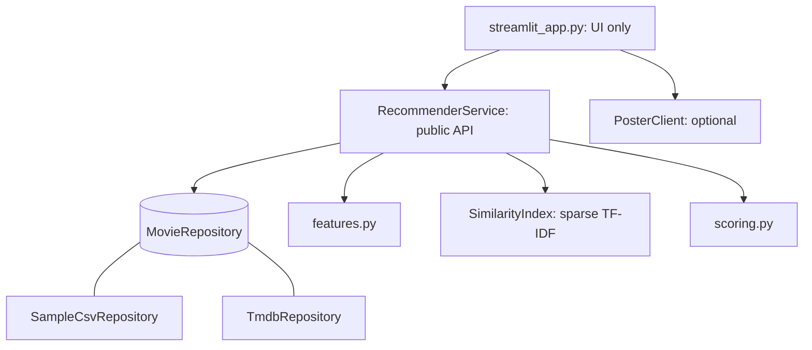

# 🎬 Movie Recommender

A content-based recommendation engine with a clean service layer and a Streamlit UI. Find movies similar to one you love, or build a taste profile from several favourites and genres.

**Tech:** Python · Pandas · NumPy · SciPy · scikit-learn · Streamlit · TMDB data/API · pytest

## Quick start
```bash
pip install -r requirements-dev.txt
streamlit run streamlit_app.py     # works instantly with the bundled sample
pytest                             # run the tests
```
**Full dataset (optional):** download *TMDB 5000 Movie Dataset* from Kaggle and put `tmdb_5000_movies.csv` and `tmdb_5000_credits.csv` in `data/`. It is detected automatically.
**Posters (optional):** `export TMDB_API_KEY=...` (free key from themoviedb.org).

## How recommendations are made
1. **Feature engineering**: each movie becomes one text document built from genres (×3), keywords (×2), cast, director and plot. Repeating a field boosts its influence.
2. **Vectorise**: TF-IDF with unigrams + bigrams → sparse matrix.
3. **Similarity**: cosine similarity between the query vector and every movie.
4. **Taste profile**: average the vectors of liked movies, add a genre vector, rank the rest.
5. **Quality blend**: `score = (1-w)·similarity + w·quality`, where *quality* is an IMDB-style Bayesian weighted rating, so a 9.0 from 3 voters can't beat an 8.4 from 30,000.

## Architecture

| Layer | Module | Responsibility |
|---|---|---|
| Presentation | `streamlit_app.py` | Widgets and layout. Zero business logic |
| Application | `service.py` | `similar_to`, `for_profile`: orchestrates everything below |
| Domain | `models.py`, `exceptions.py`, `config.py` | Immutable `Filters` / `Recommendation`, typed errors, tunable weights |
| Logic | `features.py`, `index.py`, `scoring.py` | Pure, individually testable steps |
| Data access | `repositories.py` | Loads + validates data from any source into one schema |

## Data structures and complexity
| Structure | Purpose | Why |
|---|---|---|
| `dict[str, int]` title → row | Title lookup | O(1) instead of scanning a column |
| SciPy **CSR sparse matrix** | TF-IDF vectors | Each movie uses a tiny fraction of the vocabulary, so memory is a small fraction of a dense array |
| Inverted index `dict[genre → bool mask]` | Genre filtering | Filtering becomes a vectorized OR, with no per-row Python loops |
| `np.argpartition` top-k | Pick best *k* | O(N + k log k) rather than sorting all N |
| One similarity *row* per query | Scoring | O(N) memory; never builds the N×N matrix |
| Frozen dataclasses | `Filters`, `Recommendation`, config | Immutable, self-documenting, validated on creation |

Index built once at start-up; each request is then one sparse mat-vec product plus a top-k selection.

## Design decisions
- **Repository pattern.** The engine never knows where data came from. Adding MovieLens or a database means one new class with `label` and `load()`.
- **Schema normalisation at the boundary** (`normalize`): validation, defaults and de-duplication happen once, so downstream code can trust its input.
- **Typed exceptions** (`MovieNotFoundError`, `EmptyProfileError`, `DataValidationError`) instead of generic errors or silent failures.
- **Configuration as data.** Feature weights and ranking constants live in `config.py`; no magic numbers in the logic.
- **Service is UI-agnostic.** Swap Streamlit for FastAPI by writing one thin file.
- **Optional integrations fail soft.** `PosterClient` returns `None` on any network error, so posters can never break recommendations.

## Extending it
| I want to… | Change only |
|---|---|
| Weigh cast more heavily | `FeatureWeights` in `config.py` |
| Add a new data source | new class in `repositories.py` |
| Try sentence embeddings | new class with the same methods as `SimilarityIndex` |
| Expose an HTTP API | add `api.py` calling `RecommenderService` |
| Add a ranking signal (e.g. recency) | `scoring.py` + one line in `service._recommend` |

## Possible next steps
Collaborative filtering on MovieLens ratings, a hybrid model, offline evaluation (precision@k), persisting the fitted index.
